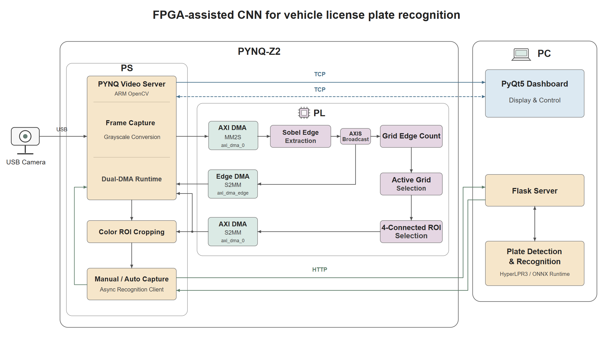
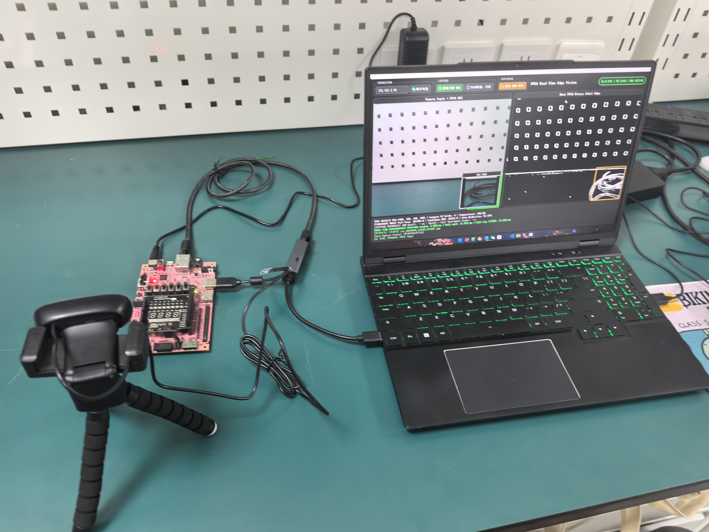
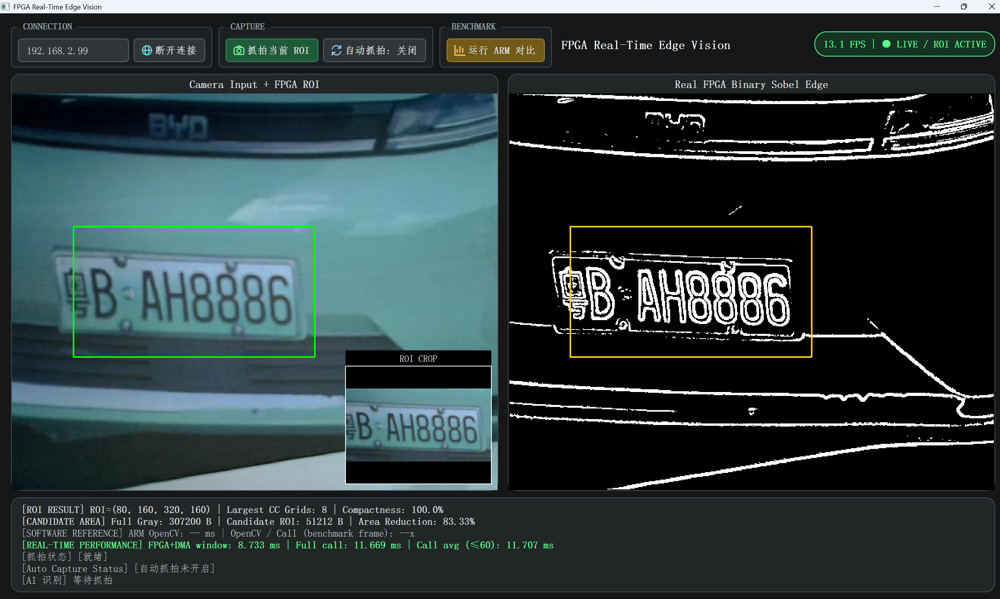

# FPGA 协同 CNN 辅助车牌识别
本项目为基于PYNQ-Z2的软硬件协同视觉系统。FPGA完成边缘提取和候选ROI筛选；ARM采集摄像头图像、调度DMA并裁剪彩色ROI；电脑运行HyperLPR3/ONNX Runtime识别服务和PyQt5双画面界面。CNN在电脑运行。

- 板卡：PYNQ-Z2 / Zynq-7020，器件xc7z020clg400-1。
- 图像：640×480，8-bit灰度；PL时钟50MHz。
- 手动抓拍：先保存有效彩色ROI，再识别。
- 自动抓拍：ROI稳定后先识别，只有成功返回非空车牌及auto_save_allowed=true才保存auto_roi图片；失败/超时不保存自动图片。



**目录**

| 位置 | 内容 |
|---|---|
| [src](src/README.md) | RTL、PS/PC软件、参考模型、识别服务及模型 |
| [sim](sim/README.md) | 4个TestBench、运行Tcl和原始日志 |
| [build](build/) | 构建入口、Tcl/XDC、综合与实现报告 |
| [board/deploy](board/deploy/README.md) | 独立上板运行包，board下另有板卡定义 |
| [data](data/README.md) | 41份测试输入、Golden、HDL向量及软件参考输出 |
| [docs](docs/) | 接口规格、架构和已有演示图片 |
| [skill](skill/README.md) | 可复用技能及示例 |
|[report](report/) |设计报告与大模型协作记录|
**复现入口**

- [电脑环境、模型准备与识别服务](src/plate_lpr_server/README.md)。
- [板端部署、Golden 验证与实时演示](board/deploy/README.md)。
- [Notebook 分模块验证](board/deploy/board_check/README.md)。
- [电脑客户端的运行方法与界面说明](src/fpga_edge_vision/software/pc/README.md)。

**构建与验证**

Vivado2025.1中新开窗口，在Tcl Console执行，根目录替换为实际仓库位置：

```tcl
set repo_root [file normalize {D:/26_FPGA_AMD_FPGA-assisted-CNN-for-vehicle-license-plate-recognition-main}]
source [file join $repo_root build rebuild.tcl]
```

入口[rebuild.tcl](build/rebuild.tcl)调用[build_bd.tcl](build/vivado/build_bd.tcl)，自动加载随包PYNQ-Z2板文件，读取[src/fpga_edge_vision/rtl](src/fpga_edge_vision/rtl/)和[XDC](build/vivado/sobel_edge_system.xdc)。生成工程写入build/work，成对bit/hwh导出board/deploy，当前报告导出build/reports/current。

RTL 行为仿真见 [仿真说明](sim/README.md)，软件参考模型测试见 [参考模型说明](src/fpga_edge_vision/software/python_ref/readme.md)，测试输入与参考结果见 [data 说明](data/README.md)。

**验证资料**

六组 RTL 仿真结果见 [sim/logs](sim/logs/)，综合与实现报告见 [build/reports](build/reports/)，板端同帧对照与识别结果见 [Notebook 执行记录](board/measurements/board_check_executed.ipynb)。

**已有演示**





[界面指标说明](docs/images/dashboard_metrics.md)、[自动抓拍示例](docs/images/auto_capture_example.png)、[架构图1](docs/images/system_architecture_1.png)、[架构图2](docs/images/system_architecture_2.png)。其余演示图片保留于docs/images。
算法接口见[fpga_interface_spec.md](docs/fpga_interface_spec.md)。识别基于第三方[HyperLPR](https://github.com/szad670401/HyperLPR)。

**许可与开源来源**

本项目团队自有源码采用 [GNU GPL v3.0（GPL-3.0-only）](LICENSE) 许可。
车牌识别使用 [HyperLPR3](https://github.com/szad670401/HyperLPR) 及其配套的 20230229 版预训练 ONNX 模型，模型并非本团队自行训练。
第三方软件、模型及厂商文件保留各自原有权利及适用许可，不纳入本项目 GPL 再授权。
来源与软件许可证见 [第三方说明](third_party_notices.md)。
 
