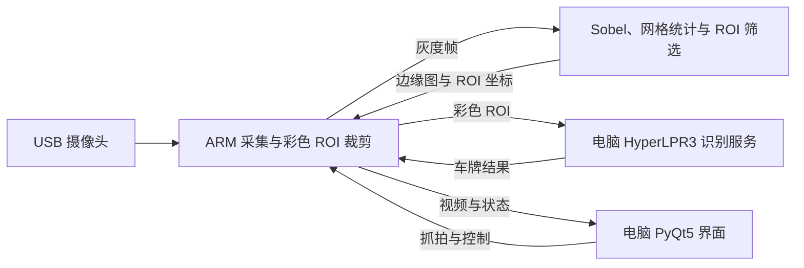

# FPGA 协同 CNN 辅助车牌识别

基于 PYNQ-Z2 的软硬件协同视觉系统。FPGA 完成边缘提取和候选区域筛选，ARM 采集摄像头图像、裁剪彩色 ROI，电脑运行车牌识别模型并通过 PyQt5 展示结果。支持原图与边缘图双画面、手动和稳定目标自动抓拍，以及同帧 OpenCV 对照。

- 硬件平台：PYNQ-Z2，Zynq-7020（`xc7z020clg400-1`）。
- 图像输入：640×480，8-bit 灰度；PL 工作时钟 50 MHz。
- 软件环境：板端 PYNQ / NumPy / OpenCV，电脑 Python 3.12 / PyQt5 / HyperLPR3 / ONNX Runtime。

## 系统架构



FPGA 使用 3×3 Sobel、8×6 网格统计和四连通最大区域筛选，双 DMA 回传 ROI 元数据与完整二值边缘图。CNN 在电脑上运行。自动抓拍由 ROI 稳定性触发，先保存彩色 ROI，再异步识别；候选区域不等同于车牌检测结果。

## 核心代码

| 位置 | 功能 |
|---|---|
| [rtl](src/fpga_edge_vision/rtl/) | Sobel、网格统计、ROI 筛选和 AXI-Stream 数据通路 |
| [pynq_video_server.py](board/deploy/pynq_video_server.py) | 板端采集、抓拍、视频传输与识别调用 |
| [edge_dma_runtime.py](board/deploy/edge_dma_runtime.py) | 双 DMA 调度、缓冲管理与结果回传 |
| [pc_dashboard.py](src/fpga_edge_vision/software/pc/pc_dashboard.py) | 电脑端双画面、控制和状态显示 |
| [server.py](src/plate_lpr_server/server.py) | HyperLPR3 / ONNX Runtime 车牌识别服务 |
| [rebuild.tcl](build/rebuild.tcl) | Vivado 硬件构建入口 |

## 仓库结构

```text
fpga_lpr/
├── src/        FPGA 工程、板端源码、电脑界面和识别服务
├── board/      板端部署文件与 PYNQ-Z2 板卡配置
├── build/      硬件构建入口和实现报告
├── sim/        RTL 仿真脚本与原始日志
├── data/       测试数据位置索引
└── skill/      可复用的联调、计时和结果核验工具
```

## 快速开始

1. 准备 PYNQ-Z2、PYNQ 镜像、USB 摄像头及联网电脑，在电脑安装 Python 3.12（64 位）。
2. 按[部署与使用说明](src/plate_lpr_server/README.md)创建电脑环境、安装依赖和初始化模型，将 `board/deploy/` 的完整内容上传板端，并运行 Golden 验证。
3. 按“电脑识别服务 → 板端视频服务 → 电脑界面”的顺序启动。板端 `--pc-ip` 填电脑地址，界面填写板子地址。

识别服务使用电脑 TCP 5000，视频和控制使用板端 TCP 8080 / 8081。电脑与板子需网络互通。

重建硬件使用 Vivado 2025.1：将 `board/board_files/` 配置为板卡仓库，在 Vivado Tcl Console 中切换到本仓库根目录，执行 `source build/rebuild.tcl`。重新生成的 `.bit/.hwh` 应配对更新到部署目录，再进行板端验证。

## 验证与文档

- [源码目录说明](src/README.md)：各源码目录的用途。
- [算法与接口规则](docs/fpga_interface_spec.md)：Sobel、网格、ROI 和数据格式。
- [RTL 仿真](sim/README.md)：模块与顶层仿真步骤，原始结果保存在 `sim/logs/`。
- [实现报告](build/reports/current/)：现有时序、资源及地址映射报告。
- [技能包](skill/README.md)：主机联调、DMA 排错、性能分析和黄金结果核验。

车牌识别使用第三方项目 [HyperLPR3](https://github.com/szad670401/HyperLPR)，模型推理由 ONNX Runtime 执行。
