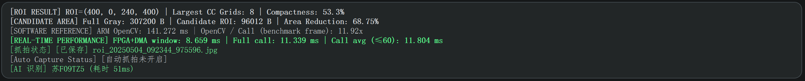

### 界面数据说明

|   指标   |   图中数值 |                     含义                                      |
|---------|----------|-----------------------------------------------------------------|
| ROI | `(400, 0, 240, 400)` | 候选区域的左上角坐标 `(x, y)` 和宽高 `(w, h)`，单位为像素|
| Largest CC Grids | 8 | 最大四连通区域包含的活跃网格数量，每格为 80×80 像素 |
| Compactness | 53.3% | 该连通域的活跃网格面积占 ROI 包围矩形面积的比例 |
| Full Gray | 307200 B | 完整灰度帧的数据量，即 `640×480×1` 字节 |
| Candidate ROI | 96012 B | 按单通道估算的候选区数据量，即 `240×400` 字节加 12 字节元数据 |
| Area Reduction | 68.75% | ROI 相比完整图像的面积缩减比例，即 `1−240×400/(640×480)`。 |
| ARM OpenCV | 141.272 ms | 最近一次基准测试中，板端 ARM 执行 OpenCV 参考算法的耗时 |
| OpenCV / Call | 11.92× | 同一基准帧的 ARM OpenCV 耗时与 FPGA 完整调用耗时之比 |
| FPGA+DMA window | 8.659 ms | 从启动 DMA 到各通道完成等待的计时窗口，包含硬件处理、数据传输和驱动开销 |
| Full call | 11.339 ms | 当前帧完整硬件调用耗时，包含输入复制、DMA 窗口及输出复制等操作 |
| Call avg (≤60) | 11.804 ms | 最近最多 60 帧完整调用耗时的平均值 |
| 抓拍状态  |  已保存     |            彩色 ROI 已保存，后面的文件名对应抓拍图片          |
| Auto Capture Status | 自动抓拍未开启 |    当前自动抓拍关闭，仍可进行手动抓拍            |
| AI 识别 | 车牌结果，51 ms | 显示识别出的车牌号；51 ms 为电脑端识别处理耗时，不含网络传输 |

### 注意：
加速比使用基准测试帧的数据，不直接用当前实时显示的 Full call 计算，也不代表整套系统或 CNN 的加速比。
Candidate ROI 是灰度数据量估算，不是实际 JPEG 文件大小；面积缩减率也不等于实际通信带宽的下降比例。

